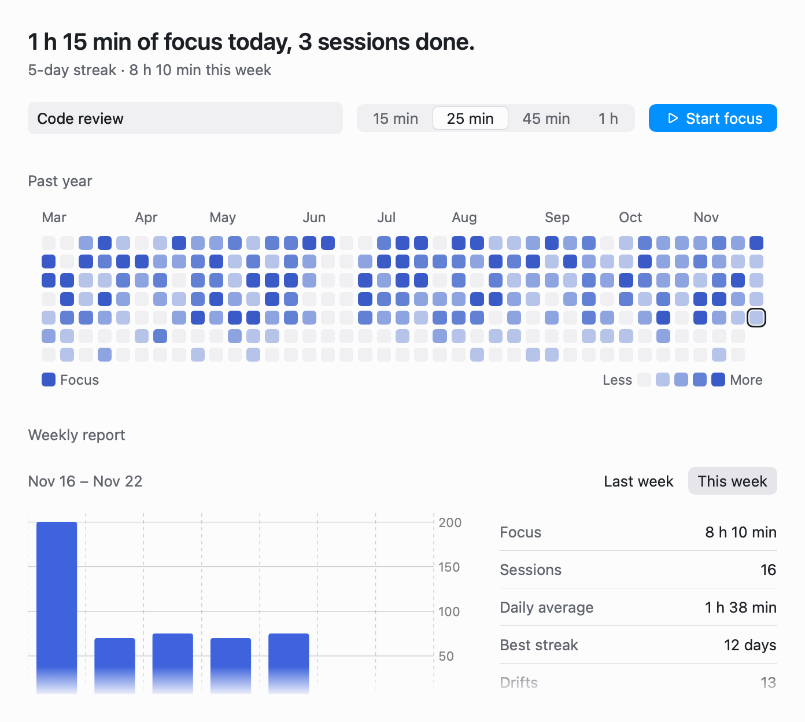
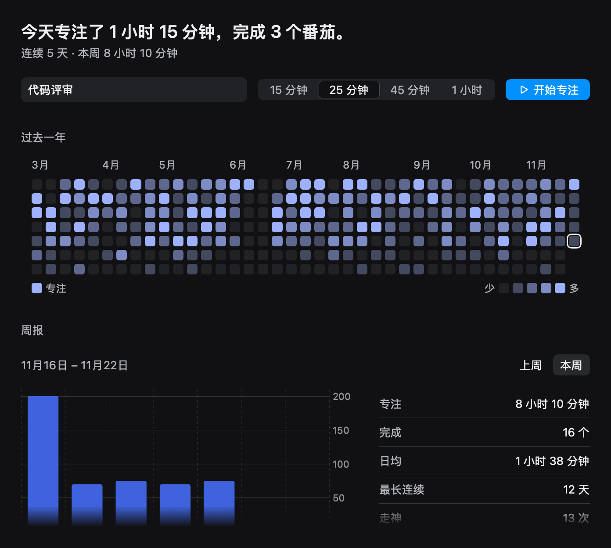

# Focus Island

Pomodoro sessions on the Dynamic Island, and a record of your focus. [中文](#专注岛)

## What it does

- **Start a session** from the launcher, the page, the island or an agent. A session is 25 minutes by default; a short break of 5 minutes follows, and every fourth session a long break of 15 minutes. Each length is a setting. Pause, resume, end, skip a break, and give a session a label.
- **The island** shows a ring and a countdown left and right of the notch. A break turns them green with a cup. When a session or a break ends, the island opens to a short card with the next step and a soft sound.
- **The menu bar** shows the time left. Its popover has the same controls.
- **Drift alerts.** While you focus, switching to an app on your distraction list (WeChat, QQ, Telegram and Discord to start with) brings a gentle note on the island, at most one a minute, with no sound. Each switch is counted against the session.
- **The page** opens with a sentence about today, then a heat map of the past year, a weekly report (minutes per day, sessions, daily average, best streak, drifts, top labels) and the sessions of the day you pick on the heat map.
- **Distracting apps** sit at the end of the page: pick installed apps from a menu with the open ones first, type any other name, and remove a capsule to drop it. The switch for drift alerts is the first setting.

## Commands

| Command | Does |
|---|---|
| `start` | Starts a focus session; takes `minutes` (1 to 180) and `label`, both optional |
| `pause`, `resume`, `stop` | Pause, resume or end the session or break on the clock |
| `skip` | Ends a break and starts the next focus session |
| `rest` | Starts the break that follows a session |
| `status` | What is on the clock, and today's totals |
| `stats` | Totals of the last `days` days (default 7): minutes, sessions, drifts, streaks, top labels, per day |
| `distractions` | Reads the distracting apps, or changes them with `add` and `remove` (app names or bundle IDs) |

The commands that change the clock answer with one sentence, such as "Focus until 12:20.", which the launcher shows as a line and a hotkey as a toast. `status` and `stats` return the fields. Agents call the same commands through Wallive's MCP server and the `wallive` CLI.

## Permissions

| Group | Why |
|---|---|
| `sys.app` | Drift alerts read which app comes to the front (`sys.app.activated`) while a focus session runs. Focus Island reads the app's name and bundle ID and keeps none of them; it stores the count of drifts. Turn off the `drift` setting and the subscription is not made. The menu of distracting apps reads the installed apps (`sys.app.list`) when the page opens. |

The island, the menu bar, the page, the database and the schedule need no permission group.

## Privacy

Nothing leaves your Mac. Focus Island makes no network request. Sessions (start, end, minutes, label, drift count) and the list of distracting apps live in the extension's database in your Wallive data folder.

## License

MIT

---

# 专注岛

番茄钟和专注统计。灵动岛上显示倒计时，菜单栏有剩余时间，专注期间切走会提醒，页面里有专注热力图和周报。

## 功能

- **开始专注**：从启动器、页面、灵动岛或 agent 开始。默认专注 25 分钟，之后短休息 5 分钟，每 4 轮一次 15 分钟的长休息，每个时长可以在设置里改。可以暂停、继续、结束、跳过休息，给这一轮写个标签。
- **灵动岛**：刘海两侧是进度环和倒计时；休息时变成绿色和一只杯子。一轮专注或休息结束，岛展开一张小卡片，写着下一步，响一声轻提示音。
- **菜单栏**：显示剩余时间，点开有同样的控制按钮。
- **走神提醒**：专注期间切到分心应用（一开始是微信、QQ、Telegram 和 Discord），岛上出现一条轻提醒，一分钟最多一次，不响铃，并记进这一轮的走神次数。
- **页面**：一句话说今天，下面是过去一年的热力图、周报（每天的分钟数、完成数、日均、最长连续、走神、常做的事），和在热力图上点选那一天的专注记录。
- **分心应用**：在页面最下面。从菜单里选装好的应用，正在运行的排在前面；也可以输入别的名字；删掉胶囊就移出清单。走神提醒的开关是设置里的第一项。

## 命令

| 命令 | 作用 |
|---|---|
| `start` | 开始一轮专注；可选 `minutes`（1 到 180）和 `label` |
| `pause`、`resume`、`stop` | 暂停、继续、结束正在走的专注或休息 |
| `skip` | 结束休息，开始下一轮专注 |
| `rest` | 开始专注之后的休息 |
| `status` | 现在的状态和今天的统计 |
| `stats` | 最近 `days` 天（默认 7）的统计：分钟、完成数、走神、连续天数、常做的事、每天的明细 |
| `distractions` | 读分心应用，或用 `add`、`remove`（应用名或 bundle ID）增删 |

改变计时的命令回一句话，例如「专注中，12:20 结束。」，启动器显示这一行，快捷键显示成提示。`status` 和 `stats` 返回字段。agent 经 Wallive 的 MCP 和 `wallive` 命令行调用同样的命令。

## 权限

| 权限组 | 用途 |
|---|---|
| `sys.app` | 专注期间读取切到前台的应用（`sys.app.activated`），用于走神提醒。读应用名和 bundle id，不保存，记下走神次数。关掉设置里的走神提醒后不订阅。打开页面时读装好的应用（`sys.app.list`），填分心应用的菜单。 |

灵动岛、菜单栏、页面、数据库和定时不需要权限组。

## 隐私

数据不离开这台 Mac。专注岛不联网。专注记录（开始、结束、分钟数、标签、走神次数）和分心应用清单存在 Wallive 数据目录里这个扩展自己的数据库。

## 许可

MIT
